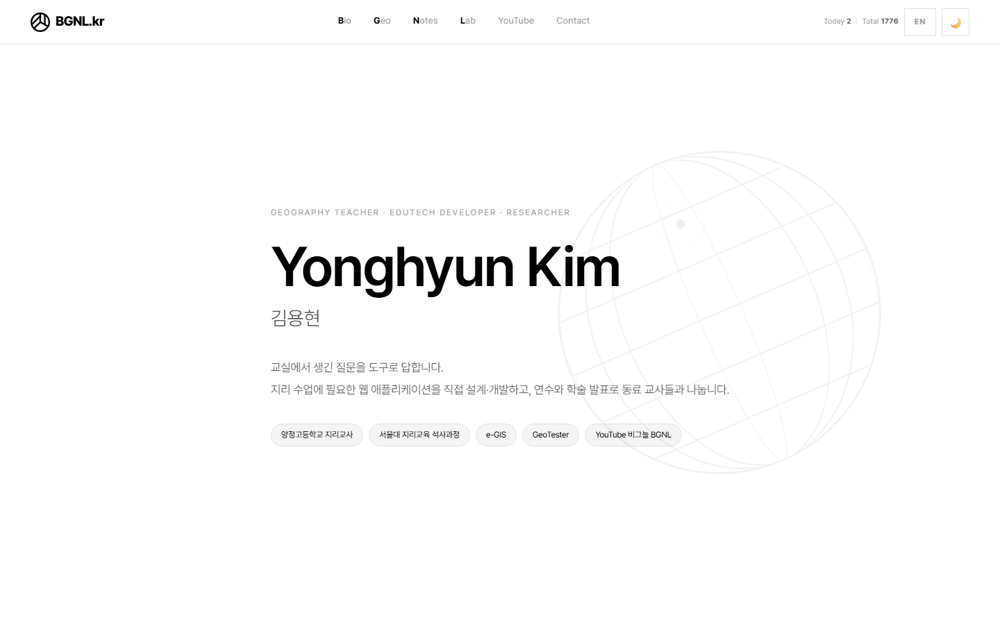

# 비그늘 (BGNL.kr)

지리교사 김용현의 개인 홈페이지입니다. 그동안 만든 수업용 웹 도구, 연수와 학술 발표 기록, 유튜브 채널을 한곳에 모아 보여 줍니다. 공개 화면 뒤에는 본인만 쓰는 대시보드와 글쓰기 도구가 함께 들어 있습니다.

- 사이트: https://bgnl.kr (영문: https://bgnl.kr/en/)



## 공개 화면

한 페이지를 내려가며 읽는 구성이고, 위쪽 메뉴로 각 구역에 바로 갈 수 있습니다.

- **첫 화면**: 이름, 한 줄 소개, 소속과 대표 프로젝트 태그를 보여 줍니다.
- **Bio**: 학력과 경력 타임라인입니다.
- **Geo**: 지리 수업 기록과 자료 글입니다(분류 「지리」).
- **Notes**: 연수와 학술 발표 기록 글입니다(분류 「글」). 글마다 요약과 블로그 원문 링크가 있습니다.
- **Lab**: 직접 만든 웹 도구 카드입니다(e-GIS, GeoTester, GeoStatAtlas, 통사랑, GeoGrapher, Projection 3D 등). 카드를 누르면 각 사이트로 갑니다.
- **YouTube**: 유튜브 채널 「비그늘 BGNL」의 최근 영상을 불러와 보여 줍니다.
- **Contact**: 인스타그램, 블로그, 유튜브, 이메일 연락처입니다.
- **그 밖에**: 라이트와 다크 모드, 한국어와 영어 전환, 오늘과 전체 방문자 수 표시가 있습니다.

## 개인 화면

주소 끝에 정해진 해시를 붙이고 비밀번호를 넣어야 들어가는 본인용 화면입니다.

- **대시보드**: 달력, 할 일, 아이디어, 습관, 목표, 방문자 통계
- **도구함**: 뽀모도로 타이머, D-Day, 북마크, 독서 목록, 이미지 자르기(`/imagecropper`)
- **일기**
- **자료실**: PDF를 저장소의 `pdfs/`에 올리고 폴더로 정리, 화면 안에서 바로 보기
- **글쓰기**: Markdown 편집기에서 글을 써서 `posts/`에 올리면 공개 화면에 바로 실립니다
- **첫 화면 편집**: 소개, 경력, Lab 카드, 연락처를 고쳐 `data/site.json`에 저장합니다

글쓰기, 자료실, 첫 화면 편집은 GitHub API로 이 저장소에 직접 커밋합니다. 그래서 본인이 발급한 GitHub 토큰(Fine-grained, 이 저장소만, Contents 읽기와 쓰기)이 필요하고, 토큰은 그 브라우저에만 저장됩니다. 대시보드와 일기 같은 개인 기록도 브라우저 저장소(localStorage)에만 남습니다.

## 데이터

| 파일 | 내용 |
|---|---|
| `data/site.json` | 첫 화면 소개, Bio, Lab 카드 목록(`projects`), 유튜브, 연락처 |
| `posts/index.json` | 글 목록. 분류(`cat`), 제목, 설명은 `{ "ko": ..., "en": ... }` 형태 |
| `posts/*.md` | 글 본문 |

Lab 카드는 `site.json`의 `projects` 배열 순서대로 나옵니다. Geo와 Notes 글은 첫 화면 편집에서 정한 순서(브라우저에 저장)를 따르고, 거기 없는 글은 `index.json` 배열 순서대로 뒤에 붙습니다.

## 실행하기

빌드 과정이 없습니다. React 18, Babel standalone, marked를 CDN에서 불러와 브라우저에서 `js/app.jsx`를 바로 실행합니다.

```
python -m http.server 8000    # http://localhost:8000
```

로컬 서버에서는 `/api/` 함수가 없어서 방문자 수와 유튜브 영상은 나오지 않습니다.

배포는 `master` 브랜치에 push 하면 됩니다. `bgnl.kr`은 Vercel이 배포하고(`api/` 함수 포함), 같은 내용이 GitHub Pages(`yhk1m.github.io`)에도 올라갑니다. 사이트에서 글을 올리면 저장소에 바로 커밋되므로, 로컬에서 고치기 전에는 꼭 `git pull`부터 합니다.

## 파일 구성

```
yhk1m.github.io/
├── index.html          한국어 첫 페이지 (React, Babel, marked 불러오기)
├── en/index.html       영어 첫 페이지 (같은 앱을 영어로)
├── js/app.jsx          앱 전체 (공개 화면, 개인 화면, GitHub API 저장)
├── css/styles.css      스타일 (흑백, 라이트와 다크)
├── fonts/              Pretendard 글꼴
├── data/site.json      첫 화면 내용
├── posts/              글 목록(index.json)과 본문(.md)
├── imagecropper/       이미지 자르기 도구
├── api/
│   ├── counter.js      방문자 수 기록과 조회 (Vercel 함수)
│   └── youtube.js      유튜브 채널 최근 영상 피드 중계 (Vercel 함수)
└── favicon.svg
```

## 만든 사람

양정고등학교 지리교사 김용현  
문의: bgnlkim@gmail.com
